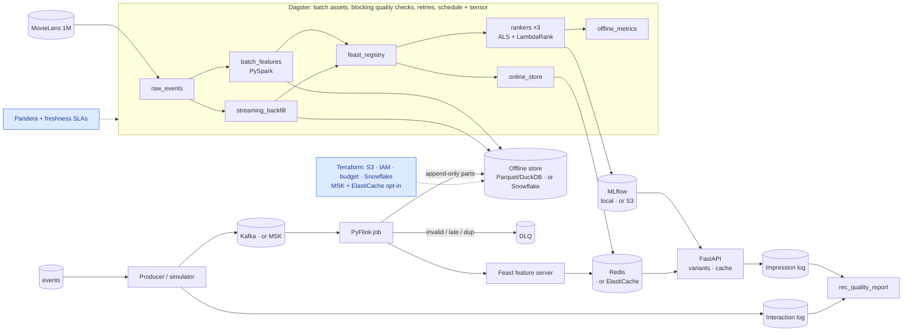
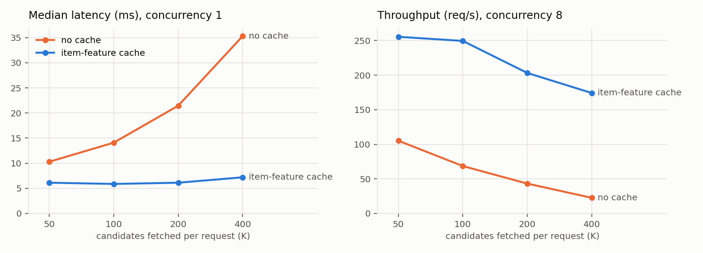
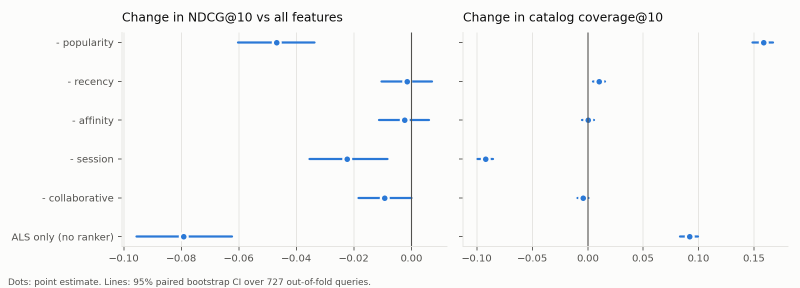

# Recommendation feature platform

A local, end-to-end recommendation system whose centerpiece is a **feature store
with online/offline consistency**: one set of Feast feature definitions feeds
point-in-time-correct training data *and* low-latency serving from Redis, so the
model sees the same feature values in both places.

The data infrastructure is the deliverable; the models (implicit ALS +
LightGBM LambdaRank) are off-the-shelf.

> **Status: Phase 4 of 5.** Core feature platform (Phase 1), streaming features
> and the measurement loop (Phase 2), Dagster orchestration with blocking data
> quality checks and Terraform for real AWS + Snowflake (Phase 3), and a
> benchmark suite with confidence intervals (Phase 4). The production loop
> (experimentation, registry, monitoring) follows (see [PLAN.md](PLAN.md)).

## Architecture



Blue = added in Phase 3. "· or X" marks the cloud equivalent selected by
`RECSYS_PROFILE=cloud` / provisioned by Terraform; the default is fully local.

## How online/offline consistency works

Train/serve skew happens when the model is trained on feature values computed
one way and served values computed another way, or from a different point in
time. Three mechanisms remove it here:

1. **One definition, two read paths.** Every feature lives in one Feast feature
   view (`src/recsys/feature_repo/definitions.py`). Training reads it with
   `get_historical_features`; serving reads the *same view* with
   `get_online_features`. The derived feature `genre_affinity` is a Feast
   on-demand feature view, so the same Python transform runs in both paths.
2. **Shared model-input code.** Training, offline evaluation and the API all
   build the ranker's input matrix with the same `FEATURE_REFS`, column order and
   `to_matrix` function (`src/recsys/features/features.py`), and candidates come
   from the same `candidates.top_k`. The API refuses to load a model trained on
   different feature refs.
3. **Checked, not assumed.** `make parity` compares every feature in Redis with
   the offline point-in-time value at serving time for 200 random (user, item)
   pairs and fails on any difference. It runs in `make demo` and in the tests.

## Why point-in-time correctness matters

A training row says: *"at time t, would this user interact with this item in the
next 7 days?"* The features on that row must be the values that existed **at t**.
Joining the latest feature values instead leaks the future into training:
`user_interaction_count` would include the very interactions being predicted,
and item popularity would include the label's own clicks. The model looks great
offline, then degrades in production where the future isn't available. That
mismatch between offline and online is train/serve skew.

Here, PySpark writes weekly feature **snapshots** (each computed only from events
strictly before its timestamp, which a test checks), and Feast's
`get_historical_features` joins each training row to the latest snapshot at or
before its anchor time. ALS candidates for each anchor come from an ALS model fit
only on events before that anchor.

## Results

### Phase 1: feature store + two-stage ranking

Measured on the fixed test period (after 2000-12-29), 1,176 users. Details in
[docs/phase-1.md](docs/phase-1.md).

| | ALS only | Two-stage (ALS + Feast features + LambdaRank) |
|---|---:|---:|
| NDCG@10 | 0.238 | **0.283** (+19%) |
| Hit-rate@10 | 0.678 | **0.758** |
| Recall@50 | 0.155 | **0.175** |

- **Online/offline parity:** 200 (user, item) pairs × 11 features identical in
  Redis and the point-in-time offline store.
- **Serving latency** (single worker, concurrency 1): p50 **14.5 ms**, p95
  **16.2 ms**, about 65 req/s. About 93% of server time is the batched Feast online
  read for 200 candidates, which is what the Phase 2 feature cache targets.
- **Reproducible:** two clean `make demo` runs gave identical metrics and
  recommendations.

### Phase 2: streaming features and the measurement loop

28-day replay of the test period, 3,054 request points served by both variants.
Outcomes are **simulated** (counterfactual replay: a click is a replayed
interaction with a shown item within 24 h). Details in [docs/phase-2.md](docs/phase-2.md).

| | batch features | batch + streaming features |
|---|---:|---:|
| CTR | 0.396 | **0.446** (+12.6%) |
| NDCG@10 | 0.098 | **0.110** (+11.9%) |
| Catalog coverage | 8.2% | **21.9%** (×2.7) |

- **Freshness:** about 100 ms from event to updated feature in Redis (Kafka →
  PyFlink → Feast push).
- **Streaming parity:** Flink's Redis values, the offline store and the shared
  logic recomputed from events agree for 300 users × 7 features (0 mismatches).
- **Item-feature cache:** p50 20.7 → **6.2 ms**, throughput 43 → **197 req/s** at
  concurrency 8, 97.8% hit rate.
- **Contracts:** 6/6 injected malformed events rejected to a dead-letter topic.

### Phase 3: orchestration, quality, infrastructure

Details in [docs/phase-3.md](docs/phase-3.md).

- **Dagster:** 11 assets, 16 checks (14 blocking data-quality + 2 freshness SLAs),
  retries, weekly schedule, new-data sensor; the full batch job runs in ~2.5 min.
- **Failure signal:** with the clock moved 2.5 weeks ahead, batch freshness fails
  (17 days old vs an 8-day SLA); a failing blocking check provably stops
  downstream assets.
- **Terraform** against real AWS + Snowflake: `plan` = 38 resources (46 with MSK
  + ElastiCache), estimated ~$2/month by default. Not applied by automation.

<!-- BENCHMARKS:START -->

## Benchmarks

Generated by `make benchmarks` from `benchmarks/results/*.json` (one knob per experiment, seeded, fixed Phase 1 split; every run is also logged to MLflow under `benchmarks-*`). ✱ = 95% CI excludes zero.

### 1. Feature freshness: batch-only vs batch + streaming

Same mid-session-trained ranker architecture, only the feature set differs; both served at all 3,054 request points of the same 28-day replay (565 users). Outcomes are **simulated** (counterfactual replay, 24 h attribution). Paired bootstrap 95% CIs.

| Metric | batch only | + streaming | Change [95% CI] | Relative |
|---|---:|---:|---|---:|
| CTR | 0.3962 | 0.4463 | +0.0501 [+0.0350, +0.0652] ✱ | +12.6% |
| Hit-rate@5 | 0.2888 | 0.3235 | +0.0347 [+0.0200, +0.0498] ✱ | +12.0% |
| NDCG@10 | 0.0980 | 0.1097 | +0.0117 [+0.0068, +0.0164] ✱ | +11.9% |
| Catalog coverage | 0.0818 | 0.2194 | +0.1376 [+0.1323, +0.1424] ✱ | +168.1% |

| Feature staleness at request time | batch only | + streaming |
|---|---:|---:|
| User events not yet reflected in features (mean) | 71.8 | 0 |
| Requests with unreflected events | 82% | 0% |
| Newest unreflected event, hours after the snapshot (mean) | 195.5 | 0 (~0.1 s pipeline) |
| Age of the batch snapshot (mean days) | 11.0 | same, but session state is live |

**Takeaway:** streaming features carry the 72 events a user has typically generated since the last batch snapshot (the current session), which lifts CTR by +12.6% and widens coverage by +168.1%, because recommendations follow what the user is doing now instead of their long-run profile.

### 2. Point-in-time join vs naive latest-value join

Identical anchors, labels, candidates and model; only the training feature join differs. Both models are then served with correct cutoff-time features on the test period (1,176 users).

| | Validation NDCG@10 (what offline eval reports) | Test NDCG@10 (how it serves) |
|---|---:|---:|
| Point-in-time (Feast `get_historical_features`) | 0.1937 | **0.2832** |
| Naive latest value | **0.2321** (+20%) | 0.2748 (-3.0%) |

Test change, naive vs PIT: -0.0084 [-0.0179, +0.0005]. Leakage diagnostics: 100% of naive training rows carry values from after their anchor; for positive rows the item's interaction count grew by 254 vs 201 for negatives, i.e. the label leaks into the feature.

**Takeaway:** the naive join lets features see the label window, so offline validation looks 20% better while the served model is 3% worse (95% CI just touches zero): leakage inflates offline metrics and trains on a feature distribution serving never sees.

### 3. Serving latency: item-feature cache and fetch batch size

`streaming_session` variant, API in Docker, 300 seeded requests per configuration, median of 3 runs. Latency is a physical measurement and varies run to run on a laptop.

| K (candidates fetched) | p50, no cache | p50, cache | p99, no cache | p99, cache | req/s c=8, no cache | req/s c=8, cache |
|---:|---:|---:|---:|---:|---:|---:|
| 50 | 10.3 ms | 6.1 ms | 19.9 ms | 9.7 ms | 105 | 256 |
| 100 | 14.1 ms | 5.9 ms | 25.5 ms | 8.3 ms | 69 | 250 |
| 200 | 21.5 ms | 6.1 ms | 91.8 ms | 8.5 ms | 43 | 203 |
| 400 | 35.3 ms | 7.2 ms | 116.1 ms | 9.8 ms | 23 | 174 |



**Takeaway:** without the cache every candidate is an online-store row to fetch and deserialize, so p50 grows linearly with K (10 → 35 ms); with item features cached only the 1-row user read remains, so latency stays nearly flat (6 → 7 ms) and K becomes a quality knob instead of a latency knob.

### 4. Feature ablation (remove one group)

5-fold CV grouped by user, 50 boosting rounds, session anchors 2000-11-03 .. 2000-12-29; 727 queries scored out-of-fold. Paired bootstrap 95% CIs; ✱ = CI excludes zero.

| Configuration | NDCG@10 | Δ NDCG@10 [95% CI] | Coverage@10 | Δ coverage |
|---|---:|---|---:|---|
| all features | 0.2319 | — | 0.187 | — |
| - popularity | 0.1850 | -0.0469 [-0.0603, -0.0337] ✱ | 0.346 | +0.159 [+0.149, +0.167] ✱ |
| - recency | 0.2304 | -0.0014 [-0.0104, +0.0073] | 0.198 | +0.010 [+0.005, +0.016] ✱ |
| - affinity | 0.2294 | -0.0024 [-0.0113, +0.0061] | 0.187 | +0.000 [-0.005, +0.006] |
| - session | 0.2096 | -0.0223 [-0.0354, -0.0082] ✱ | 0.095 | -0.092 [-0.099, -0.085] ✱ |
| - collaborative | 0.2225 | -0.0094 [-0.0184, -0.0000] ✱ | 0.183 | -0.004 [-0.009, +0.001] |
| ALS only (no ranker) | 0.1527 | -0.0792 [-0.0955, -0.0624] ✱ | 0.279 | +0.092 [+0.083, +0.100] ✱ |



**Takeaway:** popularity is the strongest accuracy signal (-0.047 NDCG when removed) and also what concentrates recommendations (coverage +0.159 without it); session features are the only group that improves accuracy and coverage together (-0.022 NDCG, -0.092 coverage when removed), and the ranker as a whole adds 0.079 NDCG@10 over ALS order.

<!-- BENCHMARKS:END -->

## Run it

Prerequisites: Docker (running), Java 17+ (for PySpark), [uv](https://docs.astral.sh/uv/),
and on macOS `brew install libomp` (OpenMP runtime for LightGBM). For the cloud
path only: Terraform ≥ 1.10, AWS credentials, a Snowflake connection in
`~/.snowflake/connections.toml`.

```bash
make demo        # fresh checkout -> Redis, features, materialize, parity, train, API, sample recs
make latency     # p50/p95/p99 + throughput against the running API
make test        # unit tests + integration tests (integration needs the pipeline built)
```

Individual steps: `make setup data features materialize parity train serve`.

Streaming (Phase 2), after `make demo`:

```bash
make train-streaming   # session-anchored rankers: batch-only vs batch + streaming features
make demo-streaming    # Kafka + Flink + feature server; live replay with DLQ; 28-day
                       # deterministic simulation; metrics report; streaming parity
make metrics           # rec-quality report from the impression/interaction logs
make produce DAYS=3 SPEEDUP=43200 MALFORMED=5   # free-running live replay
```

Orchestration and infrastructure (Phase 3):

```bash
make dagster-dev       # Dagster UI on http://localhost:3000: lineage, checks, schedules, sensors
make pipeline          # the batch job (also what `make demo` runs)
make quality           # every data-quality + freshness check, standalone
RECSYS_CLOCK=2001-01-15T00:00:00 make freshness   # rehearse a stale-feature failure
make terraform-plan    # read-only plan against your AWS + Snowflake (see docs/phase-3.md)
```

Benchmarks (Phase 4), after `make demo` and `make demo-streaming`:

```bash
make benchmarks                    # all four experiments (~20 min), regenerates the section above
make benchmarks BENCH=pit,ablation # a subset
make benchmarks-report             # re-render README tables + charts from benchmarks/results/
```

Flink dashboard: `make flink-ui`, then http://localhost:8081 (the REST port is not
published by default because it accepts unauthenticated job submissions). Kafka,
Flink and the Feast feature server
run under the docker-compose `stream` profile (`make stream-up` / `stream-down`).
`make docs-capture` regenerates the screenshots and captured output in `docs/img/`.

The API runs on `http://localhost:8000`:

```bash
curl localhost:8000/recommendations/6040        # ranked items, model_version, per-stage latency
curl localhost:8000/latency                     # server-side p50/p95/p99 per stage
```

## Docs

- [Phase 1 write-up](docs/phase-1.md): what was built, decisions, measured results, limitations
- [Phase 2 write-up](docs/phase-2.md): streaming features, cache, logging, metrics, and the bugs found on the way
- [Phase 3 write-up](docs/phase-3.md): Dagster, data quality and freshness, Terraform, local → cloud mapping, costs
- [Phase 4 write-up](docs/phase-4.md): benchmark methodology, mechanisms, reproducibility
- [Decision records](docs/decisions/)
- [Captured output and screenshots](docs/img/)
- [PLAN.md](PLAN.md): the five-phase plan
