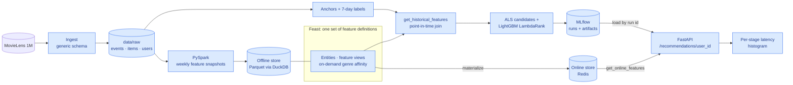

# Recommendation feature platform

A local, end-to-end recommendation system whose centerpiece is a **feature store
with online/offline consistency**: one set of Feast feature definitions feeds
point-in-time-correct training data *and* low-latency serving from Redis, so the
model sees the same feature values in both places.

The data infrastructure is the deliverable; the models (implicit ALS +
LightGBM LambdaRank) are off-the-shelf.

> **Status: Phase 1 of 5.** Core feature platform. Streaming features, impression
> logging, orchestration, cloud infrastructure, benchmarks, and the production
> loop follow in later phases (see [PLAN.md](PLAN.md)).

## Architecture



Blue = added in this phase (all of it, for Phase 1).

## How online/offline consistency works

Train/serve skew happens when the model is trained on feature values computed
one way and served values computed another way, or from a different point in
time. Three mechanisms remove it here:

1. **One definition, two read paths.** Every feature lives in one Feast feature
   view (`src/recsys/feature_repo/definitions.py`). Training reads it with
   `get_historical_features`; serving reads the *same view* with
   `get_online_features`. The derived feature `genre_affinity` is a Feast
   on-demand feature view, so the same Python transform runs in both paths.
2. **Shared model-input code.** Training, offline evaluation and the API all
   build the ranker's input matrix with the same `FEATURE_REFS`, column order and
   `to_matrix` function (`src/recsys/features/features.py`), and candidates come
   from the same `candidates.top_k`. The API refuses to load a model trained on
   different feature refs.
3. **Checked, not assumed.** `make parity` compares every feature in Redis with
   the offline point-in-time value at serving time for 200 random (user, item)
   pairs and fails on any difference. It runs in `make demo` and in the tests.

## Why point-in-time correctness matters

A training row says: *"at time t, would this user interact with this item in the
next 7 days?"* The features on that row must be the values that existed **at t**.
Joining the latest feature values instead leaks the future into training:
`user_interaction_count` would include the very interactions being predicted,
and item popularity would include the label's own clicks. The model looks great
offline, then degrades in production where the future isn't available. That
mismatch between offline and online is train/serve skew.

Here, PySpark writes weekly feature **snapshots** (each computed only from events
strictly before its timestamp, which a test checks), and Feast's
`get_historical_features` joins each training row to the latest snapshot at or
before its anchor time. ALS candidates for each anchor come from an ALS model fit
only on events before that anchor.

## Results (Phase 1)

Measured on the fixed test period (after 2000-12-29), 1,176 users. Details in
[docs/phase-1.md](docs/phase-1.md).

| | ALS only | Two-stage (ALS + Feast features + LambdaRank) |
|---|---:|---:|
| NDCG@10 | 0.238 | **0.283** (+19%) |
| Hit-rate@10 | 0.678 | **0.758** |
| Recall@50 | 0.155 | **0.175** |

- **Online/offline parity:** 200 (user, item) pairs × 11 features identical in
  Redis and the point-in-time offline store.
- **Serving latency** (single worker, concurrency 1): p50 **14.5 ms**, p95
  **16.2 ms**, about 65 req/s. About 93% of server time is the batched Feast online
  read for 200 candidates, which is what the Phase 2 feature cache targets.
- **Reproducible:** two clean `make demo` runs gave identical metrics and
  recommendations.

## Run it

Prerequisites: Docker (running), Java 17+ (for PySpark), [uv](https://docs.astral.sh/uv/),
and on macOS `brew install libomp` (OpenMP runtime for LightGBM).

```bash
make demo        # fresh checkout -> Redis, features, materialize, parity, train, API, sample recs
make latency     # p50/p95/p99 + throughput against the running API
make test        # unit tests + integration tests (integration needs the pipeline built)
```

Individual steps: `make setup data features materialize parity train serve`.
`make docs-capture` regenerates the screenshots and captured output in `docs/img/`.

The API runs on `http://localhost:8000`:

```bash
curl localhost:8000/recommendations/6040        # ranked items, model_version, per-stage latency
curl localhost:8000/latency                     # server-side p50/p95/p99 per stage
```

## Docs

- [Phase 1 write-up](docs/phase-1.md): what was built, decisions, measured results, limitations
- [Decision records](docs/decisions/)
- [Captured output and screenshots](docs/img/)
- [PLAN.md](PLAN.md): the five-phase plan
