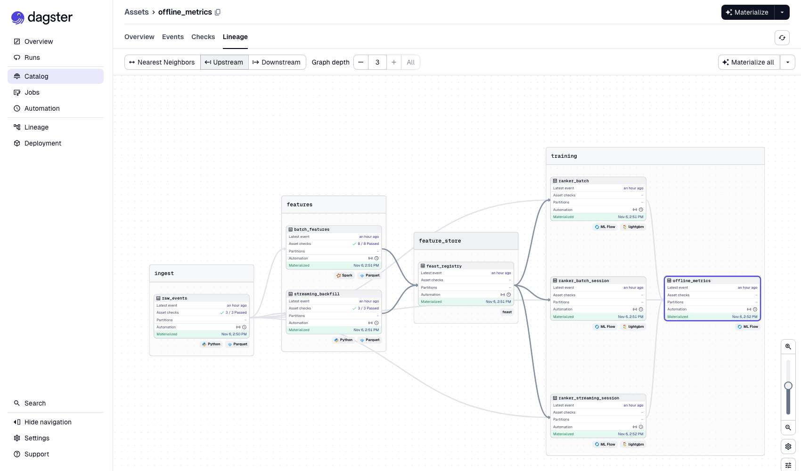
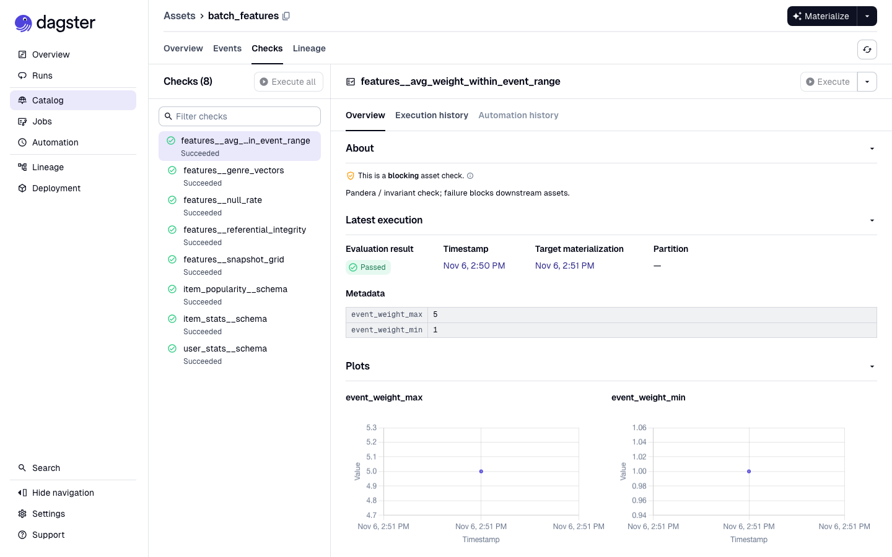
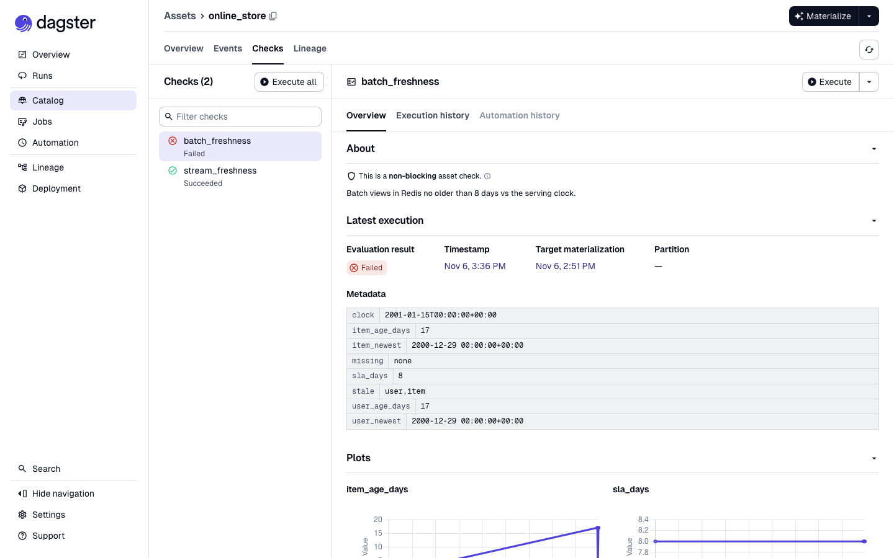

# Phase 3: Orchestration, data quality, infrastructure as code

**Goal:** run the batch path like production (lineage, retries, schedules,
sensors), enforce data quality and freshness with clear failure signals, and
define the real cloud footprint (AWS + Snowflake) in Terraform, while
`make demo` keeps working with no cloud account.

## What was built

| Piece | Implementation |
|---|---|
| Orchestration | Dagster code location `recsys.orchestration`: 11 assets in 5 groups (ingest, features, feature_store, training, measurement), `batch_pipeline` job, weekly schedule, hourly freshness schedule, `new_raw_data` sensor (`data/landing/*.zip`), `logs_changed` sensor ([ADR 0011](decisions/0011-dagster-assets-and-blocking-checks.md)) |
| Data quality | 14 Pandera / invariant checks as **blocking** Dagster asset checks on raw events, batch features and streaming features ([ADR 0012](decisions/0012-quality-and-freshness-checks.md)); also standalone via `make quality` |
| Freshness | Batch SLA (8 days) and streaming SLA (300 s of event time) on the online store, run with the pipeline and hourly |
| Reliability | Exponential-backoff `RetryPolicy` on every asset; retries inside Flink's pushes; failing checks stop downstream assets (tested) |
| Terraform | `bootstrap/` (state bucket), `modules/aws` (lake + MLflow buckets, IAM, budget, optional VPC + MSK + ElastiCache), `modules/snowflake` (warehouse, resource monitor, database, schema, role, key-pair service user, grants, S3 storage integration, Parquet format, external stage) ([ADR 0013](decisions/0013-terraform-layout-state-and-cost-gating.md)) |
| Cloud profile | `RECSYS_PROFILE=cloud`: Feast offline store → Snowflake (`SnowflakeSource`s, key-pair auth), MLflow artifacts → S3; `make demo-snowflake` loads Snowflake via the stage and compares point-in-time retrieval with the local store |
| Hardening | Loopback-only ports, Flink REST and the feature server not published ([ADR 0014](decisions/0014-local-service-exposure.md)) |

## The orchestration



```
raw_events ──[3 blocking checks]──┬─> batch_features ──[8 checks]──┐
                                  └─> streaming_backfill ─[3 checks]┴─> feast_registry ─> online_store ──[freshness ×2]
                                                                               └─> ranker_batch ───────────────┐
                                                                               ├─> ranker_batch_session ───────┼─> offline_metrics
                                                                               └─> ranker_streaming_session ───┘
impression_logs (observable source: API + simulator) ─> rec_quality_report
```

- `make pipeline` runs the whole job; `make data | features | materialize |
  train | train-streaming` materialize single assets (with their checks).
- Assets record MLflow run ids and test metrics as metadata, so the Dagster
  asset catalog links to the model lineage in MLflow.
- The streaming job stays a long-running service outside Dagster; the
  streaming freshness check watches it.

## Data quality and freshness

All 16 checks pass on the real data ([standalone run](img/phase3-quality.txt)).
Blocking checks in the UI:



**Failure signal, rehearsed.** With the clock moved to 2001-01-15 (as if the
weekly batch job had stopped for 2.5 weeks), `batch_freshness` fails with
ERROR severity and says why: newest user and item features are 17 days old
against an 8-day SLA. The streaming check still passes.



**And a real one.** After `make demo-streaming` replays 28 days, the event-time
clock stands at 2001-01-25 while no weekly batch job ran during the replay, so
`make quality` fails batch freshness at 27.9 days (stream lag 0). That is the
check doing its job: in production the weekly schedule would have refreshed the
snapshots. `make stream-reset` returns the clock to the cutoff.

**Blocking, verified.** `tests/test_orchestration.py` injects a failing raw-data
check and asserts that the downstream asset never runs and the run fails.

## Infrastructure as code

`make terraform-plan` against the real AWS and Snowflake accounts (read-only):

| Configuration | Resources |
|---|---:|
| default | **38 to add** ([resource list](img/phase3-terraform-plan.txt), account id redacted) |
| `enable_msk` + `enable_elasticache` | 46 to add |
| bootstrap (state bucket) | 4 to add |

Nothing has been applied: applying creates billable resources, so it is left to
the account owner (see "What you need to run" below).

### Local → cloud mapping

| Local (default) | Cloud (`RECSYS_PROFILE=cloud`) | Terraform |
|---|---|---|
| `data/offline/*.parquet` (Feast offline, DuckDB) | Snowflake `RECSYS.FEATURES.*` tables, loaded from `s3://recsys-lake-<acct>/offline/` through the `LAKE_OFFLINE` external stage | `modules/snowflake`, `modules/aws/s3.tf` |
| DuckDB compute | Snowflake `RECSYS_WH` (XS, 60 s auto-suspend, 10-credit monthly monitor) | `modules/snowflake` |
| `mlruns/artifacts` | `s3://recsys-mlflow-<acct>/artifacts` | `modules/aws/s3.tf` |
| Redis (docker) | ElastiCache Redis 7.1, TLS + AUTH, `cache.t4g.micro` (optional) | `modules/aws/cache.tf` |
| Kafka (docker, KRaft) | MSK 3.8, 2 × `kafka.t3.small`, IAM auth + TLS (optional) | `modules/aws/streaming.tf` |
| Flink (docker) | Flink on EKS or Amazon Managed Service for Apache Flink, in the VPC (Phase 5 option) | not yet |
| no auth, loopback | IAM roles (app, Snowflake integration), key-pair service user, least-privilege grants | `modules/aws/iam.tf`, `modules/snowflake` |
| — | AWS Budget alarm, S3 state bucket | `modules/aws/budget.tf`, `bootstrap/` |

### Production deployment story

In production the same code runs with the cloud profile: Dagster runs the batch
assets on a schedule against Snowflake (offline store) and S3 (lake, MLflow
artifacts); Flink consumes from MSK and pushes features through the Feast
feature server into ElastiCache, appending offline rows to Snowflake natively;
the serving API runs next to ElastiCache inside the VPC. MSK and ElastiCache
have no public endpoints, which is why Phase 3 defines them but the laptop path
keeps local Kafka and Redis; Phase 5 adds an optional EKS deployment that can
reach them.

### Cost

| | Default | With MSK + ElastiCache |
|---|---:|---:|
| Estimated monthly | **~$2** (Snowflake XS for occasional demos, S3 pennies) | ~$85 |

Guards: Snowflake resource monitor (10 credits/month, suspends at 100%), AWS
Budget alarm (80% actual, 100% forecast of $25), cost tags on every resource,
`make terraform-destroy`.

## What you need to run (cloud)

```bash
cp infra/terraform/envs/main/terraform.tfvars.example infra/terraform/envs/main/terraform.tfvars  # set alert_email
make terraform-bootstrap   # one time: S3 state bucket (asks to confirm)
make terraform-plan        # review
make terraform-apply       # creates the resources, writes .env.cloud
make demo-snowflake        # load Snowflake, compare PIT retrieval with local, materialize from Snowflake
make terraform-destroy     # when done
```

## Limitations

- **The cloud path has not been executed end to end.** `terraform plan` ran
  against both real accounts (authentication and configuration verified), and
  the cloud profile's configuration is unit-tested, but `terraform apply` and
  `make demo-snowflake` have not been run because they create billable
  resources. Expect first-run adjustments in `demo-snowflake` around how
  Snowflake infers Parquet timestamp and array types.
- One environment (`dev`); a `prod` env would be a second `envs/` directory with
  its own state key.
- The Dagster instance is local (SQLite in `data/dagster`); production would use
  Postgres-backed storage and a run launcher.
- Freshness SLAs are thresholds on event time, not alerts routed to a pager;
  Phase 5 adds alerting.
