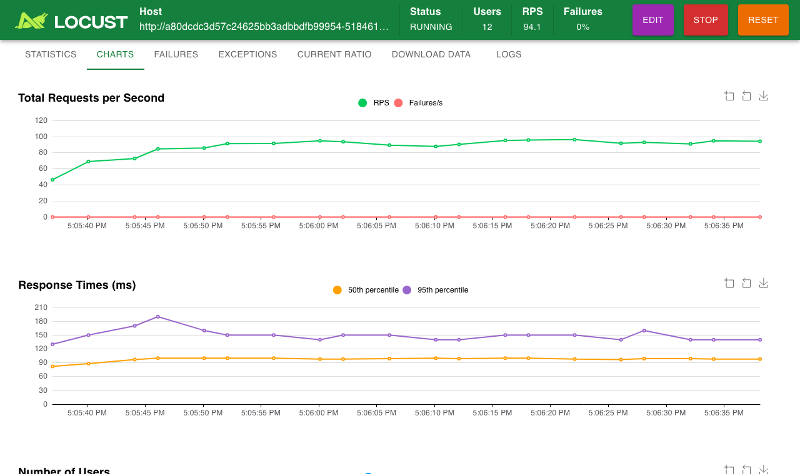
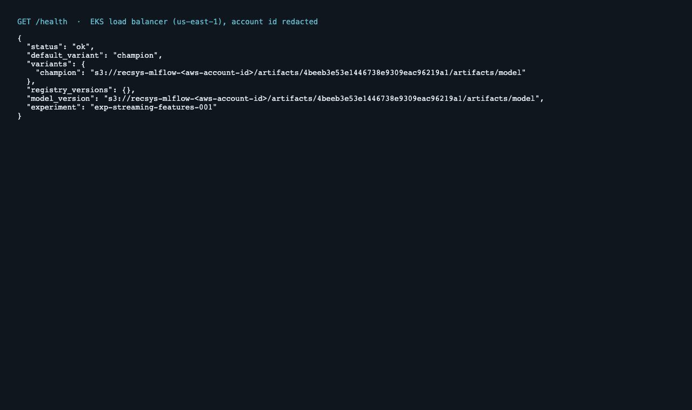
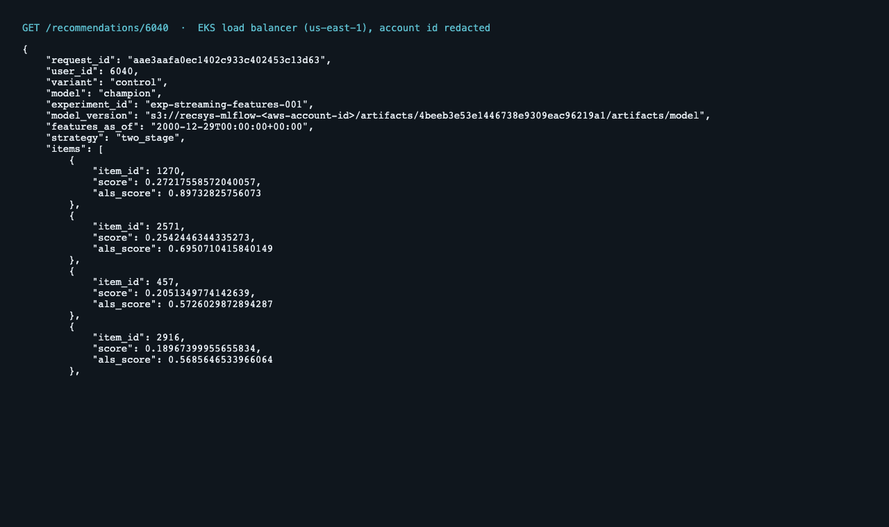
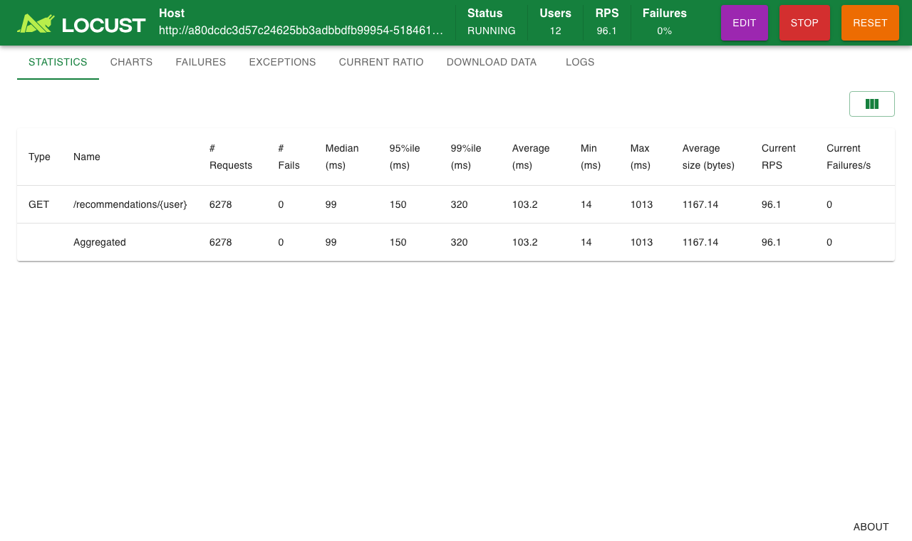

# Phase 5 on real AWS: a temporary EKS session

The production path from Phase 5 was brought up on AWS for half an hour,
measured, captured, and torn down again, with a scripted check that nothing
billable from the session remained. The Phase 3 base (S3, IAM, budget,
Snowflake) stays in place.

Runner: [`scripts/eks_session.py`](../scripts/eks_session.py) ·
Captures: [`docs/eks-session/`](eks-session/) · Account id, IP addresses and
credentials are redacted in every artifact.

## What ran

```
Snowflake (feature tables, Phase 3) ──────────────┐
S3: model files (trained from Snowflake features) │
S3: Feast registry                                 │
                                                   ▼
  EKS 1.37 · 1 × t4g.medium (ARM) · VPC from Phase 3
  ├─ Job recsys-materialize   Snowflake ──> ElastiCache (Redis 7.1, TLS + AUTH)
  ├─ Deployment recsys-api ×2  non-root, read-only root fs, Pod Identity for S3
  ├─ Job recsys-loadtest       3,000 requests from inside the cluster
  └─ Service (load balancer)   reachable only from the operator's IP
```

| Step | What it proves |
|---|---|
| `terraform apply` with `enable_eks` and `enable_elasticache` | the opt-in Phase 5 infrastructure builds on the Phase 3 base |
| Image built on Apple Silicon, pushed to ECR, run on Graviton | ARM end to end, no cross-compilation |
| Materialize Job reads Snowflake, writes ElastiCache | the cloud offline → online path works inside the VPC, where ElastiCache is reachable |
| API loads the model straight from S3 | serving needs no tracking server; the model was trained on Snowflake features earlier the same day |
| In-cluster load test | serving latency without the internet in the path |
| Teardown + verification | the session leaves no billable resources |

## Results

From [`results.json`](eks-session/results.json) and the [session log](eks-session/session.log):

| | Result |
|---|---|
| Bring-up (30 resources) | 12.5 min |
| Snowflake → ElastiCache materialization | 67 s; 5,998 users, 3,678 items across 5 feature views |
| In-cluster latency, 1 client | p50 **19.9 ms**, p95 24.1 ms, p99 **30.2 ms**, 49 req/s (SLO 50 ms: met) |
| In-cluster latency, 8 clients | p50 85.9 ms, p99 230.5 ms, 86 req/s (SLO: breached) |
| Server-side online-feature stage | p50 9.6 ms (local Docker: ~2 ms with the cache) |
| From the laptop over the internet (Locust, 12 users) | median 87 ms, p95 150 ms, 0 failures |
| Tear-down | 12.0 min; verification: no recsys EKS cluster, ElastiCache group, EC2 node, Kubernetes load balancer or ECR repository left |
| Wall time | 29.6 min |

**Reading the numbers.** One client stays well inside the 50 ms SLO. Eight
concurrent clients saturate two API replicas on a single 2-vCPU node (86 req/s
total), and queueing pushes p99 to 230 ms: the fix is capacity (more replicas
and nodes, or the multi-worker serving noted in Phase 1), which this
deliberately minimal session did not buy. Online feature reads are slower than
in local Docker because ElastiCache is a network hop with TLS; the item-feature
cache keeps most of that off the request path. The Locust numbers include the
round trip from the laptop to us-east-1, so they are an end-to-end view, not the
SLO measurement.

## Captures

**Terminal recording** of the whole session, idle time compressed, 4× speed:
[`eks-session-terminal.mp4`](eks-session/eks-session-terminal.mp4) (22 s),
also as an asciinema recording [`session.cast`](eks-session/session.cast).

**Live load test** against the EKS load balancer, recorded in the browser:
[`eks-live-loadtest.mp4`](eks-session/eks-live-loadtest.mp4) (60 s).



| | |
|---|---|
|  |  |
| `GET /health`: champion loaded from S3 | `GET /recommendations/6040` served by EKS |



## What went wrong first (and the fixes)

It took three runs. Each failure was caught, recovered, and fixed in code:

1. **Credentials expired mid-apply.** The AWS CLI's `aws login` session hands
   out credentials that last about 15 minutes; EKS takes longer to create.
   Terraform could not save state or release its lock, and the scripted
   teardown failed with the same expired credentials. Recovery: Terraform had
   written the unsaved state to `errored.tfstate`; after refreshing credentials
   the stale lock was released, the state pushed back, the interrupted node
   group (actually healthy) untainted, and everything torn down. Fix: the
   session now uses a profile whose `credential_process` asks the CLI for fresh
   credentials on every call, so long operations never outlive them.
2. **`kubectl` was refused.** With EKS's API authentication mode this provider
   version does not make the creator an admin implicitly. Fix: an explicit
   access entry granting cluster-admin to the operator, visible in Terraform.
3. **The materialize Job never finished.** Kubernetes mounts secret files
   root-owned with the requested mode (0400), which the non-root user (uid 10001)
   cannot read; a local Docker run passed because macOS bind mounts do not
   enforce that. Fix: `fsGroup: 10001` and mode 0440. The runner now also
   streams Job logs, fails fast on pod errors, and saves pod status, events and
   logs before teardown, so a failure always leaves evidence.

## Cost

All three runs together kept EKS, ElastiCache and one t4g.medium node alive for
roughly two hours in total: on the order of **$1**, within the estimate. The
AWS Budget alarm (80% of $25) did not trigger.

## Re-run

```bash
make eks-session MODEL_URI=s3://<mlflow bucket>/artifacts/<run>/artifacts/model
```

Prerequisites: the Phase 3 base applied (`make terraform-apply`), features
loaded into Snowflake (`make demo-snowflake`), and a model trained under the
cloud profile. The session always tears down in a `finally` block; if the
machine itself dies mid-run, `make eks-destroy EKS=1` removes EKS and
ElastiCache.
