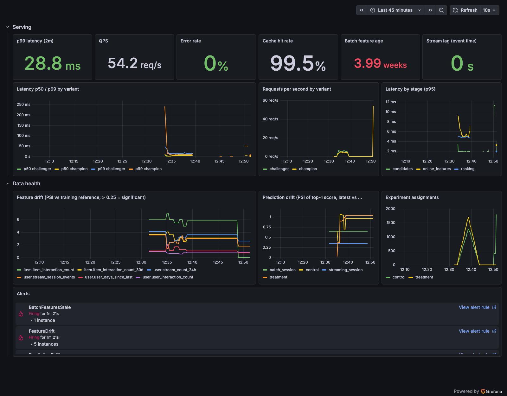

# Phase 5: The production loop

**Goal:** close the loop around the platform: ship models through a registry
with metric-gated promotion and rollback, test them with real per-user A/B
assignment and significance testing, and watch serving and data health with
Prometheus, Grafana and alert rules. Fully local and zero-cost by default.

## What was built

| Piece | Implementation |
|---|---|
| Assignment | `recsys.experiments.assignment`: `sha256(experiment:salt:user) mod 10000` → arm by weight; `config/experiments.yaml`; the API assigns requests that name no variant and logs the arm in the impression contract's `experiment_id` / `variant` fields reserved since Phase 2 ([ADR 0016](decisions/0016-ab-experimentation.md)) |
| A/B run | `make experiment`: Phase 2 lockstep replay in `--experiment` mode (one request per request point; the API assigns) |
| Lift analysis | `recsys.experiments.lift`: user-level deltas with bootstrap CIs (Phase 4 `independent_diff`), permutation tests, impression-level z-test (flagged optimistic), sample-ratio-mismatch chi-square, bucket-leakage check, coverage and p99-latency guardrails, ship / do-not-ship / inconclusive decision |
| Contract evolution | Impression schema v2 adds optional `latency_ms` (additive; v1 rows remain valid; readers use `union_by_name`) |
| Registry | MLflow registry `recsys-ranker` (version = full two-stage bundle), aliases `champion` / `challenger`, champion history for rollback; MLflow server + UI in docker-compose ([ADR 0017](decisions/0017-registry-and-promotion-gate.md)) |
| Gate | data-quality checks (Phase 3) + held-out non-inferiority on paired NDCG@10 (Phase 4 `paired_diff`, margin 0.005); decisions logged to MLflow `promotions` and tagged on versions; rejected challengers lose the alias |
| Continuous training | Dagster `retrain_and_promote` job; `fresh_features_retrain` asset sensor fires on new `batch_features` |
| Serving | variants may be registry aliases; `POST /admin/reload` + 30 s poll swap models on promotion/rollback without a restart; removed aliases stop being served |
| Monitoring | API `/metrics` (latency histogram, requests, errors, cache, model info, assignments); drift exporter (PSI feature + prediction drift, freshness); Prometheus with 7 alert rules; provisioned Grafana dashboard ([ADR 0018](decisions/0018-monitoring-drift-and-alerts.md)) |
| Optional | `K8S=1`: Helm chart + kind + Locust SLO test; `EKS=1`: Terraform for EKS + ECR in the Phase 3 VPC with ElastiCache ([ADR 0019](decisions/0019-optional-deployment-paths.md)) |

## Results

### A/B experiment (simulated outcomes)

`exp-streaming-features-001`: control = champion v1 (batch features),
treatment = challenger v2 (+ streaming features), 50/50 by user, 28-day replay
([full report](img/phase5-lift-report.txt)).

| Per user | control | treatment | Δ [95% CI] | permutation p |
|---|---:|---:|---|---:|
| CTR | 0.259 | 0.282 (+8.8%) | +0.023 [−0.034, +0.078] | 0.43 |
| Hit-rate@5 | 0.157 | 0.202 (+28.6%) | +0.045 [−0.003, +0.092] | 0.07 |
| NDCG@10 | 0.056 | 0.067 (+18.6%) | +0.011 [−0.006, +0.026] | 0.19 |

- 262 / 303 users (SRM p = 0.085, ok), 0 users in both buckets.
- Guardrails: coverage +169% (floor −10%), treatment p99 13.6 ms (SLO 50 ms).
- The impression-level CTR z-test says p = 0.006, but impressions cluster within
  users, so it overstates the evidence.
- **Decision: inconclusive.** The direction matches Phase 2/4's paired replay
  (CTR +12.6%, CI excluding zero), but a between-user A/B design over 565 users
  has far less power than a paired comparison of the same requests. This is the
  practical argument for running offline counterfactual evaluation before (and
  to size) a live test: at this effect size the A/B test needs several times
  more users.

### Registry: promote, reject, roll back

From [the registry state](img/phase5-registry.json) and the MLflow UI:

| Step | Version | Outcome |
|---|---|---|
| bootstrap | v1 batch_session | champion |
| bootstrap | v2 streaming_session | challenger (A/B treatment) |
| `make retrain` (Dagster) | v5 streaming_session | **promoted**: NDCG@10 +0.016 [−0.002, +0.034] vs v1 over 428 held-out queries, data quality ok; serving switched within the 30 s poll |
| `make retrain-bad` | v6 shuffled labels | **rejected**: NDCG@10 −0.108 [CI low −0.128]; alias removed so it is never served |
| `make rollback` | v5 → v1 | champion restored; serving switched immediately via `/admin/reload` |

(v3 and v4 were registered by two retrain attempts that failed at the gate
step before a packaging fix; they were never aliased or served. A clean
`make demo-production-loop` produces the same decisions as v3 promoted, v4
rejected, rollback v3 → v1, with identical gate statistics.)

### Monitoring

- Serving: p99 28.8 ms at 54 req/s (SLO 50 ms), error rate 0%, cache hit rate
  99.5%; per-variant latency and request rates during the experiment.
- Data health: batch features 28 days old after the replay (`BatchFeaturesStale`
  firing), stream lag 0 s.
- Drift, after a methodology fix (see below): item lifetime popularity stable
  (PSI 0.02); streaming session features shifted strongly (PSI ~2.6) because the
  training window was November's sign-up burst while the replay period is
  returning users in short holiday sessions; 30-day item counts dropped after
  November's spike (PSI 1.8). These are genuine distribution shifts, the signal
  the retraining sensor exists for.
- Prometheus: `FeatureDrift`, `PredictionDrift` and `BatchFeaturesStale` firing;
  latency and error SLO alerts inactive ([screenshot](img/phase5-prometheus-alerts.png)).

## Problems found and fixed

1. **A rejected challenger kept serving traffic.** After the gate rejected v6 it
   was still aliased `challenger`, the experiment's treatment arm. Rejection now
   removes the alias and the API drops variants whose alias disappeared.
2. **Drift that was really selection bias.** The first exporter compared all
   catalog items at training time with only the *shown* items now (PSI 5.8 on a
   feature that had not changed) and per-event streaming rows with per-user
   states. Both sides now use the same population definition; item popularity
   PSI fell to 0.02.
3. **Stale gauges** from earlier runs' variants kept firing; label sets are
   cleared each cycle.
4. **"No data" error rate** when nothing fails: `or vector(0)` in the panel and alert.
5. **The gate failed inside Dagster** because the Phase 4 comparison module was
   only importable from the repo root; `benchmarks` is now part of the package.
6. **Serving read a stale registry.** The API's pooled SQLite connection kept an
   old snapshot, so `/admin/reload` missed an alias another process had just
   moved (the 30 s poll eventually caught up). Reload now drops pooled
   connections first and accepts the expected versions, retrying until it sees
   them; promote and rollback take effect immediately.
7. **Security review findings, fixed:** `/admin/reload` now requires a bearer
   token (generated into `.secrets/`, exported by the Makefile; disabled when
   unset); the image runs as uid 10001 and the Helm pod as non-root with a
   read-only root filesystem, no privilege escalation, all capabilities dropped
   and `mlruns` mounted read-only; on EKS, lake/MLflow access moved from the node
   role to a pod-scoped role via EKS Pod Identity, with IMDSv2 (hop limit 1) so
   pods cannot use the node's credentials.
8. **Network outage mid-phase** (GitHub, including ghcr.io, unreachable): the
   Dockerfile now installs `uv` from PyPI instead of copying it from ghcr.io.

## Limitations

- Outcomes are simulated; the A/B analysis is correct for real traffic, but
  this traffic is replayed behaviour.
- The gate's held-out set is the validation period that also drove early
  stopping; it is shared by both models (fair) but optimistic in absolute terms.
- Alertmanager routing (pager, Slack) is not configured.
- **Not executed:** the K8S path (kind and Helm were not installed) and the EKS
  path (billable; `terraform plan` with EKS + ElastiCache resolves to 62
  resources). Both are flag-gated and documented in ADR 0019.
- MLflow's tracking server shares the SQLite store with the host tools; a
  production setup would use Postgres and S3 (the cloud profile already sends
  artifacts to S3).

## Artifacts

- [Lift report](img/phase5-lift-report.txt), [registry state](img/phase5-registry.json)
- [Grafana](img/phase5-grafana.png), [MLflow registry](img/phase5-mlflow-registry.png),
  [Prometheus alerts](img/phase5-prometheus-alerts.png)
- Regenerate: `make demo-production-loop`, then `make docs-capture PHASE=5`.
